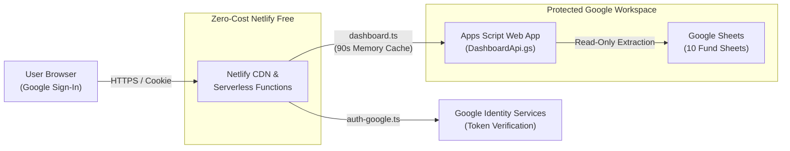

# AURA | 3D Mutual Fund Portfolio Intelligence

A production-grade, personal mutual fund portfolio dashboard built with **React, TypeScript, Vite, Tailwind CSS, Three.js (React Three Fiber & Drei), and Netlify Serverless Functions**.

Integrates seamlessly with your existing Google Sheets mutual fund tracker and AMFI historical backfill system while strictly maintaining **Zero-Cost Hosting ($0.00 / month)** on the **Netlify Free Tier**.

---

## 🌟 Key Highlights

- **Interactive 3D Investment Universe**: Three.js / React Three Fiber interactive solar system where the central luminous star represents overall portfolio health, and 10 orbiting nodes represent your mutual funds with real-time color-coded alert signals, valuations, and interactive click/hover states. Includes an automatic 2D interactive radar fallback.
- **Strictly Zero-Cost Architecture**: Built exclusively for the **Netlify Free Plan** (300 build credits/month). Zero paid databases, zero paid third-party APIs, zero subscriptions. Your Google Sheets remains the single source of truth.
- **Total Protection for Existing Google Apps Script**: The web app uses a dedicated read-only adapter (`DashboardApi.gs`). It **never** writes to or modifies your sheets, and never interferes with daily AMFI fetchers, triggers, or email notifications.
- **Server-Side Google Identity Services Authentication**: Secure Google One-Tap / OAuth sign-in. Verified on the serverless backend against an authorized email allowlist (`DASHBOARD_ALLOWED_EMAILS`), issuing encrypted `HttpOnly`, `SameSite=Lax`, `Secure` session cookies.
- **Smart Serverless Caching**: 90-second in-memory caching on Netlify serverless functions conserves monthly credits and ensures lightning-fast sub-second dashboard rendering without hitting Apps Script quota limits.
- **Algorithmic Buy-on-Dip Matrix**: Highlights funds trading at significant discounts (≥ 2.0% dip from 10-day peaks) alongside 10-day highs/lows and historical purchase averages.
- **Interactive Historical Analytics Drawer**: Slide-over drawer with high-resolution historical NAV charts powered by Recharts, supporting 1M, 3M, 6M, 1Y, and ALL time horizons.

---

## 🏗 System Architecture



---

## 📋 The 10 Tracked Mutual Funds

| # | AMFI Scheme Code | Google Sheet Name | Mutual Fund Name | Category |
|---|---|---|---|---|
| 1 | `118989` | `HDFC-M-FundData` | HDFC Mid-Cap Opportunities Fund | Mid Cap Fund |
| 2 | `148519` | `Nippon-S-250-FundData` | Nippon India Nifty Smallcap 250 Index Fund | Small Cap Index |
| 3 | `118633` | `Nippon-Large-FundData` | Nippon India Large Cap Fund | Large Cap Fund |
| 4 | `127042` | `MO-M-FundData` | Motilal Oswal Midcap Fund | Mid Cap Fund |
| 5 | `118666` | `Nippon-G-M-FundData` | Nippon India Growth Fund | Mid Cap Fund |
| 6 | `119721` | `SBI-L&M-FundData` | SBI Large & Midcap Fund | Large & Mid Cap |
| 7 | `120586` | `ICICI-Pru-Large-FundData` | ICICI Prudential Bluechip Fund | Large Cap Fund |
| 8 | `119774` | `Kotak-M-FundData` | Kotak Emerging Equity Fund | Mid Cap Fund |
| 9 | `118835` | `Mirae-L-M-FundData` | Mirae Asset Large & Midcap Fund | Large & Mid Cap |
| 10 | `118775` | `Nippon-S-FundData` | Nippon India Small Cap Fund | Small Cap Fund |

---

## 🚀 Setup & Deployment Guide (100% Free)

### Step 1: Install `DashboardApi.gs` in Google Apps Script

1. Open your Google Spreadsheet tracking the mutual funds.
2. In the top menu, go to **Extensions** → **Apps Script**.
3. In the left files list, click the **+** (Add a file) icon → select **Script**.
4. Name the new file `DashboardApi.gs`.
5. Copy and paste the entire contents of `DashboardApi.gs` (located in this repository) into the editor.
6. In the function dropdown at the top, select **`setupDashboardApiSecret`** and click **Run**.
   - It automatically checks or generates a secure token and logs the key and value:
     ```
     KEY NAME: DASHBOARD_API_SHARED_SECRET
     SECRET VALUE: MUTUAL_FUND_SECURE_TOKEN_...
     ```
   *(Note: Save this secret value. You will paste it into your Netlify dashboard in Step 4).*
7. Test the data extraction: In the function dropdown, select **`testDashboardApi`** and click **Run**. Check the Execution Log to ensure it logs portfolio valuation and funds correctly.
8. Click **Deploy** (top right) → **New deployment**:
   - **Select type**: Click the gear icon ⚙️ → **Web app**.
   - **Description**: `Mutual Fund Dashboard API (Read-Only)`
   - **Execute as**: `Me (your Google email)`
   - **Who has access**: `Anyone` *(Required so Netlify serverless functions can reach the endpoint; protected via the shared secret).*
9. Click **Deploy**, authorize permissions if prompted, and **copy the Web App URL**:
   `https://script.google.com/macros/s/AKfycbxXXXXXXXXXXXXXXXXXXXXXXXXXXXXX/exec`

---

### Step 2: Create a Free Google OAuth 2.0 Client ID

To enable secure Google Sign-In with Google Identity Services:

1. Go to the [Google Cloud Console](https://console.cloud.google.com/).
2. Create a new project (or select an existing one).
3. Navigate to **APIs & Services** → **OAuth consent screen**:
   - User Type: **External**
   - App Name: `AURA Portfolio Dashboard`
   - User Support Email: *Your email*
   - Test Users: Add your personal Google email (and any family members you wish to grant access to).
4. Navigate to **APIs & Services** → **Credentials**:
   - Click **+ CREATE CREDENTIALS** → **OAuth client ID**.
   - Application type: **Web application**.
   - Name: `AURA Netlify Web App`.
   - **Authorized JavaScript origins**:
     - `http://localhost:3000` (for local development preview)
     - `https://YOUR-SITE-NAME.netlify.app` (your Netlify production URL from Step 3)
5. Click **Create** and copy your **Client ID** (e.g., `XXXXXXXXXXXX-XXXXXXXXXXXXXXXXXXXXXXXX.apps.googleusercontent.com`).

---

### Step 3: Deploy to Netlify Free Tier ($0 Cost)

#### Option A: Deploy via GitHub (Recommended)

1. Push this project folder to your GitHub repository:
   ```bash
   git init
   git add .
   git commit -m "Deploy 3D Mutual Fund Dashboard"
   git remote add origin https://github.com/YOUR_USERNAME/mutual-fund-3d-portfolio.git
   git push -u origin main
   ```
2. Log in to [Netlify](https://app.netlify.com/) (Free plan).
3. Click **Add new site** → **Import an existing project** → **GitHub**.
4. Select your repository.
5. Build settings are auto-configured via `netlify.toml`:
   - **Base directory**: *(Leave blank / root)*
   - **Build command**: `npm run build`
   - **Publish directory**: `dist`
   - **Functions directory**: `netlify/functions`
6. Click **Deploy site**.

#### Option B: Deploy via Netlify CLI

```bash
# Install Netlify CLI globally
npm install -g netlify-cli

# Build and deploy directly
npm run build
netlify deploy --prod
```

---

### Step 4: Configure Netlify Environment Variables

In your Netlify Dashboard, go to:
**Site configuration** → **Environment variables** → **Add a variable** (add each of the following):

| Variable Name | Description | Example |
|---|---|---|
| `VITE_GOOGLE_CLIENT_ID` | OAuth Client ID exposed to browser for Google Sign-In | `123456789-abcdefg.apps.googleusercontent.com` |
| `GOOGLE_CLIENT_ID` | OAuth Client ID used by Netlify Functions to verify token audience | `123456789-abcdefg.apps.googleusercontent.com` |
| `DASHBOARD_ALLOWED_EMAILS` | Comma-separated list of authorized Google emails | `your.email@gmail.com,family@gmail.com` |
| `SESSION_SECRET` | 32+ character random string to sign cookies | `3f8a91b2c4d5e6f7a8b9c0d1e2f3a4b5c6d7e8f9` |
| `DASHBOARD_API_URL` | Deployed Apps Script Web App URL from Step 1 | `https://script.google.com/macros/s/AKfycb.../exec` |
| `DASHBOARD_API_SHARED_SECRET` | Secret token logged by `setupDashboardApiSecret()` | `MUTUAL_FUND_SECURE_TOKEN_...` |

> [!TIP]
> After saving environment variables in Netlify, go to **Deploys** → **Trigger deploy** → **Clear cache and deploy site** to ensure all serverless functions load the fresh environment variables.

---

## 🔒 Security & Privacy Guarantees

1. **No External Databases**: No Firebase, Supabase, Redis, or PostgreSQL. Zero data replication outside your Google Sheets account.
2. **Server-Side Email Allowlist**: Only Google accounts matching `DASHBOARD_ALLOWED_EMAILS` can log in. Unauthorized users are blocked with HTTP 403.
3. **Stateless HMAC Sessions**: Session tokens are cryptographically signed with HMAC-SHA256 and stored in `HttpOnly; Secure; SameSite=Lax` browser cookies, immune to XSS token theft.
4. **Protected Apps Script Endpoint**: Requests without the exact `DASHBOARD_API_SHARED_SECRET` are rejected with HTTP 401.
5. **Strictly Read-Only**: `DashboardApi.gs` does not call `setValue`, `appendRow`, `deleteRow`, or any mutating Google Sheets API. Your historical NAV records, purchase history, formulas, and daily triggers are 100% safe.

---

## 💻 Local Development

To run the application locally on your computer:

```bash
# 1. Install dependencies
npm install

# 2. Copy environment template
cp .env.example .env

# 3. Start local development server
npm run dev
```

Visit `http://localhost:3000` in your browser. The application includes a **Demo Mode** fallback so you can explore the 3D Universe, historical charts, and alert matrix even before connecting live Google credentials.

---

## ⚖️ Statutory Disclaimer

Mutual fund investments are subject to market risks, read all scheme related documents carefully. Past performance is not indicative of future returns. The alerts generated by this tool are mathematical indicators based on 10-day moving average variances and do not constitute SEBI-registered investment advice or recommendations.
